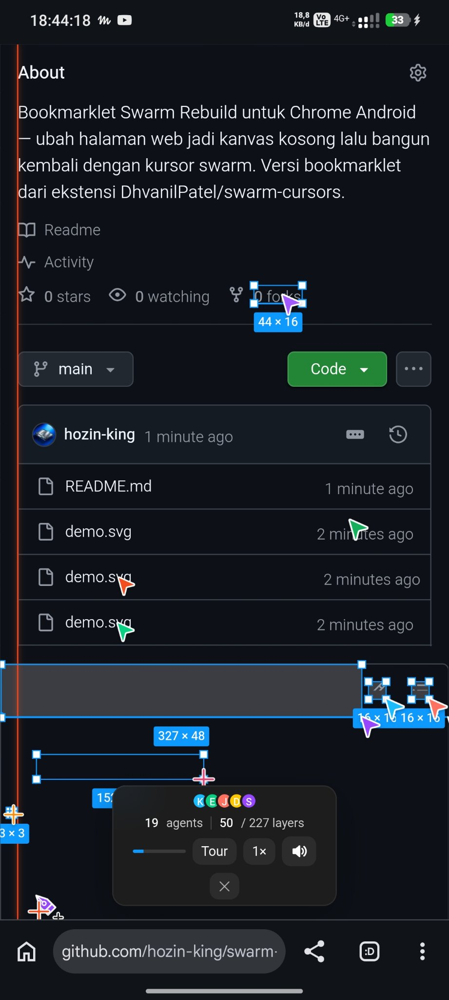

# Swarm Rebuild — Bookmarklet for Chrome Android

[](https://github.com/hozin-king/swarm-rebuild-bookmarklet/stargazers)
[](LICENSE)
[](https://github.com/hozin-king/swarm-rebuild-bookmarklet/commits/main)
[](https://github.com/hozin-king/swarm-rebuild-bookmarklet)

Turn any web page into a blank canvas, then watch colorful swarm cursors rebuild it live — right in Chrome Android, with no app to install. One tap on the bookmark and the effect runs.

This is a bookmarklet version of the **Swarm Rebuild** Chrome extension by [DhvanilPatel](https://github.com/DhvanilPatel/swarm-cursors) (a tribute to Joel Califa's Swarm site). The original extension is desktop-only — this version brings it to Android phones via a bookmark, the same trick as Eruda.

> 📖 **Versi Bahasa Indonesia:** [README.md](README.md)


## Contents

- [Features](#features)
- [Tested on a real device](#tested-on-a-real-device)
- [Quick start](#quick-start)
- [Install on Chrome Android](#install-on-chrome-android)
- [How to use](#how-to-use)
- [Hide the bar temporarily](#hide-the-bar-temporarily)
- [Screenshot mode](#screenshot-mode)
- [FPS meter](#fps-meter)
- [Settings](#settings)
- [Mobile optimization](#mobile-optimization)
- [Performance on phones (anti-lag)](#performance-on-phones-anti-lag)
- [Automatic updates](#automatic-updates)
- [FAQ](#faq)
- [How it works](#how-it-works)
- [Limitations](#limitations)
- [Changelog](#changelog)
- [Credits & license](#credits--license)

## Features

- 🖱️ **Live rebuild** — the page is wiped to a blank canvas, then rebuilt block by block by swarm cursors.
- 📱 **Optimized for phones** — the bottom bar is restyled to fit small screens, including the Android gesture-bar safe area.
- 🚀 **Anti-lag** — GPU-heavy effects are disabled and rendering is capped at ~30fps on phone screens.
- 👁️ **Hidable bar** — hide the bottom bar temporarily without stopping the rebuild, while building or after it finishes.
- 📷 **Screenshot mode** — one tap hides ALL swarm elements (bar, cursors, FPS, pill) so the page can be screenshotted cleanly.
- 📊 **FPS meter** — a live frames-per-second number in the bottom-left corner, switchable from Settings.
- ⚙️ **Settings** — a small panel for speed, sound, FPS, and render throttle (every control actually works — no fake toggles).
- 🔄 **Automatic updates** — the bookmark loads the loader from this repo, so fixes apply without editing the bookmark.
- 🔁 **Toggle** — one tap turns it on, another turns it off.

## Tested on a real device

Tested on a real device — **POCO X6 Pro, Chrome Android**. The compact bottom bar in this screenshot is the result of the mobile patch (compare with the first version, where the bar was cut off on both sides):



## Quick start

1. Copy the [bookmarklet code](#bookmarklet-code) below.
2. Create a new bookmark in Chrome Android, then edit its URL to the code (name it `Swarm Rebuild`).
3. Open any page → ⋮ → **Bookmarks** → tap **Swarm Rebuild**. Done.

## Bookmarklet code

Copy the code below in full (one line). This is a **stub** — its only job is to load the loader from this repo. All logic (including updates) lives in the repo, so the bookmark never needs to change again:

```js
javascript:(function(){var s=document.createElement('script');s.src='https://cdn.jsdelivr.net/gh/hozin-king/swarm-rebuild-bookmarklet@main/swarm-bookmarklet.js';s.onerror=function(){alert('Swarm Rebuild gagal dimuat. Cek koneksi internet atau CSP halaman ini.');};(document.head||document.documentElement).appendChild(s);})();
```

## Install on Chrome Android

Chrome Android strips the `javascript:` scheme when pasted into the address bar, so install it by editing a bookmark:

1. Open any page in Chrome, then create a bookmark as usual (tap ⋮ → the star icon).
2. Open the bookmark list (⋮ → **Bookmarks**) and find the bookmark you just created.
3. Long-press it, then choose **Edit**.
4. Change the **Name** to `Swarm Rebuild`.
5. Change the **URL** to the bookmarklet code above (paste it in full, one line).
6. Save. Done — the bookmarklet is ready to use on any page.

## How to use

1. Open any web page (for example a news article).
2. Open Bookmarks (⋮ → **Bookmarks**), then tap **Swarm Rebuild**.
3. The page is wiped to a blank canvas, then the swarm cursors rebuild it block by block. The bar at the bottom of the screen shows progress (`48 / 156 layers`) and `scroll to keep building` if there is more of the page below that has not been rebuilt yet.
4. Tap the bookmarklet again to turn the effect off and return to the original page.

Buttons on the bottom bar:

- **Tour** — auto-scrolls while the swarm builds.
- **1×** — build speed (tap to change).
- **Go live** — return to the original page once the rebuild is done.
- **Replay** — wipe and rebuild from the start.
- **▾** — hide the bar temporarily (see below).
- **⚙** — open the Settings panel (see below).
- **📷** — screenshot mode: hide all swarm elements at once (see below).
- **✕** — exit.

## Hide the bar temporarily

If the bottom bar covers the page being rebuilt, tap the **▾** button at the end of the bar. The bar disappears, but the rebuild **keeps running** in the background — the cursors keep working. A small **👁 Show bar** pill appears in the bottom-right corner; tap it to bring the bar back. The **✕** button (exit swarm) is untouched and keeps working; if the bar is hidden, show it first and then tap ✕, or press back/Escape.

The ▾ button works in **both bar states** — while still building and after it finishes ("Rebuilt by N agents..."). The finished bar is the same HUD, only its status text and buttons change, so the hide button stays in the same place.

## Screenshot mode

A screenshot captures every DOM element visible on screen — including the bar, the cursors, and the FPS meter. **There is no way to hide elements automatically when a screenshot is taken**, so the only way is to hide them before taking the shot and show them again after. Screenshot mode does that in one tap:

1. Tap the **📷** button on the bottom bar.
2. All swarm elements disappear at once: the bar, all cursors, badges, ruler lines, the FPS meter, and the pill.
3. Take the screenshot as usual.
4. Tap anywhere on the page to bring everything back.

Note: while screenshot mode is active, a small toast appears ("Screenshot mode — tap anywhere to restore") and fades away on its own after ~2 seconds. Don't tap any bar button while in this mode — there are no buttons left; a tap on the page area restores the view.

## FPS meter

A small pill in the bottom-left corner shows a **live FPS number** (frames per second) while the swarm runs — useful for feeling whether a page lags on your phone. The number is computed from smoothed animation-frame deltas (a ~500ms rolling average).

- The pill hides together with the bar or in screenshot mode.
- On phone screens it sits a bit higher so it doesn't overlap the two-row bar.
- It can be switched off from the Settings panel (⚙ → FPS meter → Off).

Honest note: this measures the page's animation-frame loop, not the GPU directly — use it as a rough sense of lag, not a benchmark.

## Settings

Tap the **⚙** button on the bottom bar to open a small Settings panel (phone-friendly). It only contains controls that actually work — every control was verified against the upstream code before being added:

- **Speed** — 1× / 2× / 3× (changes the real `engine.speed`; the 1× button on the bar changes along). Disabled after the rebuild finishes, because speed only matters while building.
- **Sound** — On / Off (changes the real `sfx`; off by default on phones).
- **FPS meter** — On / Off.
- **Render throttle** — On / Off (the ~30fps cap from v2; turn it off if your phone is strong enough and you want the smoothest possible rebuild).
- **Hide bar** — hides the bar (same as the ▾ button).

**Why is there no agent-count setting?** The agent count is a constant inside the upstream code (min 8, max 48, flock 36) that is not exposed — there is no API to change it. Adding a toggle would mean a fake toggle: a button that does nothing. So it isn't there. Settings are temporary per page (not saved across pages).

## Mobile optimization

The first version's bottom bar was cut off on phone screens (the agent avatar was missing on the left, the `1×` button was flush against the right edge) because the bar was designed for desktop: about 600px wide, while a phone viewport is only ~360–430px.

This version adds `swarm-mobile.js` — a small patch that tidies the bottom bar specifically on small screens:

- The bar's width is limited to the screen width, wrapping to a second row when needed.
- Font, spacing, and buttons are shrunk so everything fits.
- The bar no longer collides with the Android gesture bar (safe area).
- Desktop is completely untouched — the patch only activates on screens ≤600px.

The patch is loaded automatically by the bookmarklet. If the patch fails to load (for example, no internet), Swarm Rebuild still runs normally, as in the first version.

## Performance on phones (anti-lag)

To keep phones from lagging, the patch also lightens the rendering load on small screens:

- **Blur filters off**: the per-image blur animation, backdrop blur, and per-cursor drop shadows are the heaviest load on a phone GPU — all are replaced with lighter effects (plain fades, solid backgrounds). The rebuild looks the same, just slightly less "sparkly".
- **Rendering capped at ~30fps**: the view updates every second frame; the rebuild logic still runs at full speed, so nothing is skipped or broken. It can be switched off from Settings (⚙ → Render throttle → Off) if your phone is strong enough.
- **Sound off by default**: the swarm sounds don't turn on by themselves on phones (saves battery). Tap the sound button on the bottom bar to turn them on.

Deliberately **not** changed: the cursor count (set by the engine itself, 8–48 cursors, can't be locked from outside without breaking how it works) and the build speed (still your choice via the 1× button — faster means heavier per frame).

Honest note: how much of a difference this makes depends on the phone and how heavy the page is — the real numbers can only be felt by testing on an actual device, not from a simulation.

## Automatic updates

The bookmark above **never needs to change again** when there is an update. How it works:

- The bookmark only loads `swarm-bookmarklet.js` from this repo (the `main` branch, via jsDelivr). Every fix — the mobile patch, loader fixes, even the upstream pin — just gets pushed to this repo and applies without touching the bookmark.
- The upstream `swarm.js` also follows the latest version (the author's `main` branch). If the latest version fails to load (for example, the file was moved), the loader automatically falls back to commit `3d49e0ac`, which is already tested.
- The jsDelivr cache usually refreshes a few minutes after a push, at most a few hours. If you just updated but the bookmark still loads the old version, wait a bit and try again.

## FAQ

**Is this a website clone?**
No. This is a visual rebuild: Swarm wipes the page and then rebuilds it in front of your eyes. Animations freeze when clicked, and no site files are produced or saved.

**Do I need to install an app?**
No. This is a bookmarklet — just an ordinary bookmark containing JavaScript code. No app, no extension, no weird permissions.

**Does it render with the GPU?**
Yes, partly. Cursor and layer movement already use `transform: translate()` + `will-change: transform`, so the GPU compositor does the moving. What makes phones struggle isn't the position — it's how many elements get synced every frame plus the cost of repainting — which is why patch v2 turns off blur/shadows and caps rendering at ~30fps. Swarm doesn't draw to a canvas/WebGL because it rebuilds the real DOM (still clickable, original structure) — changing that would mean rewriting the engine, not just a patch.

**Why doesn't it work on some sites?**
Sites with a strict CSP (for example github.com, google.com) can block scripts from a CDN. `chrome://` pages can't be reached by a bookmarklet either.

**Does this bookmarklet collect data?**
No. The bookmarklet only loads two scripts: the loader from this repo and `swarm.js` from the author's repo (both via jsDelivr). No tracking, no data sent anywhere.

**Can I use it on desktop Chrome?**
Yes — the code is the same. The mobile patch only activates on screens ≤600px, so on desktop the bar looks just like the original extension.

**How do updates work?**
Automatically. The bookmark loads the loader from this repo (`main`), so every push applies as soon as the jsDelivr cache refreshes (a few minutes to a few hours).

**How do I take a screenshot without the bar/cursors?**
Use screenshot mode: tap the 📷 button on the bar, all swarm elements disappear, then take the shot. A screenshot captures every DOM element, so there is no automatic way — they have to be hidden first. Tap anywhere on the page to bring everything back.

**Why is there no agent-count setting?**
The agent count is a constant inside the upstream code (8–48) that isn't exposed — there is no API to change it. Adding a toggle would mean a fake toggle, so it isn't there.

**Why does my bottom bar look different from the original video?**
That's the mobile patch: the bar is tidied up to fit phone screens. On desktop, the bar looks like the original.

## How it works

The bookmarklet loads scripts in order:

1. **The stub in the bookmark** loads `swarm-bookmarklet.js` from this repo (`main`, via jsDelivr).
2. **The loader** loads the original `swarm.js` from [DhvanilPatel/swarm-cursors](https://github.com/DhvanilPatel/swarm-cursors) — the latest version (`main`), with an automatic fallback to commit `3d49e0ac`, which is already tested, if it fails. Once loaded, this script runs by itself; loaded a second time, it turns the effect off (toggle).
3. **The loader** then loads `swarm-mobile.js` from this repo — a patch injected into Swarm Rebuild's shadow root so the bottom bar fits on phone screens, runs lighter, and can be hidden. If it fails to load, the effect still runs without the patch.

This repo does **not** include a copy of `swarm.js` — the original file is always fetched from the author's repo.

## Limitations

- **This is a visual rebuild, not a clone.** Animations freeze when clicked, decorative elements (pseudo-elements) are skipped, and canvas/video/iframes below the first screen become placeholders. No site files are produced or deployed.
- Maximum around 4,000 layers / 40,000px per page.
- Internet is needed the first time it loads on each page (scripts come from a CDN).
- Sites with a strict CSP (for example github.com, google.com) can block scripts from a CDN.
- Doesn't work on `chrome://` pages.
- Must be tapped again on every page change or refresh.

## Changelog

See [CHANGELOG.md](CHANGELOG.md) — v1.0 initial bookmarklet, v1.1 auto-update stub, v2.0 anti-lag + hideable bar, v3.0 screenshot mode + FPS meter + Settings.

## Credits & license

- Swarm Rebuild: [DhvanilPatel/swarm-cursors](https://github.com/DhvanilPatel/swarm-cursors) — a tribute to Joel Califa's Swarm site.
- The upstream repo is currently unlicensed. The author asks not to reuse the code without checking with Joel Califa — this repo respects that: no upstream code is redistributed here, it is only loaded directly from the author's repo, plus a small patch (`swarm-mobile.js`) of our own.
- The loader, patch, guides, and demo in this repo are licensed under [MIT](LICENSE). That license does **not** cover the upstream `swarm.js`.

---

⭐ If this bookmarklet made you smile, give the repo a star — it's free, and it keeps the maker going.
